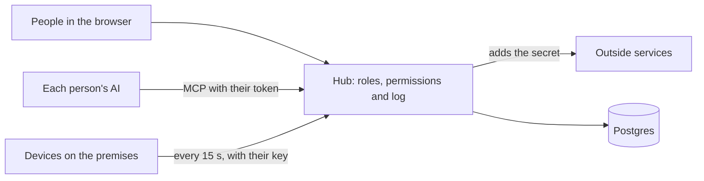

# Architecture

## The idea

A company uses many services (accounting, CRM, telephony, shipping) and some devices (printers, readers, cameras). The hub brings them together in one place and puts a single door in front of them, with people and roles. People come in through that door with a browser, and their AIs come in through the MCP server.

## The five parts

### People and roles

A person has an email and a role. A role is a list of permissions (`lib/permissions.ts`). A permission is text with parts separated by colons: `log:read`, `connector:crm:write`, `device:warehouse-printer:use`, `tool:orders`. The asterisk matches any part, so `connector:*:read` allows reading every connector.

Sign-in is with email and password (scrypt). The administrator adds the person in Team and the hub gives a single-use link, valid for 7 days, so the person can set a password. If `GOOGLE_CLIENT_ID` and `GOOGLE_CLIENT_SECRET` are set, people can also sign in with Google, as long as the email is already registered.

`requireAccess(permission)` from `lib/session.ts` is the door to every page and every action.

### Connectors

A connector stores the base URL of a service's API, how the hub authenticates (a Bearer header, another header, a URL parameter, or a username and password) and the encrypted secret. `callConnector()` from `lib/connectors.ts` makes the call with four guarantees: the URL stays inside the connector's base URL, the caller's authentication headers are dropped, redirects are not followed, and the secret is masked if it appears in the response.

Each connector gives two permissions: `connector:<slug>:read` for GET and `connector:<slug>:write` for everything else.

### The MCP server

`/api/mcp` speaks MCP over stateless HTTP (`lib/mcp/protocol.ts`). An AI identifies itself with a person's token. There are two ways to get one: a personal token created in "My AI", or the OAuth 2.1 flow with PKCE and dynamic client registration (`lib/oauth.ts`), which is the one used by apps where you only paste a URL.

A tool (`lib/mcp/types.ts`) declares a name, a description, an input schema in zod, a permission and a function. `lib/mcp/server.ts` shows each person only their own tools, checks the permission on every call and writes the log. The built-in tools are in `lib/mcp/core.ts`: `hub_whoami`, `log_search`, `log_add`, `connectors_list`, `connector_request`, `devices_list` and `device_enqueue`. The company's tools go in `tools/`.

### Log

The `log` table stores who, through which channel (web, mcp, device or system), what kind and what. The hub writes the `usage` kind on every MCP call, with the arguments summarized and nothing that looks like a secret. A person or their AI writes the `decision`, `change`, `project` and `note` kinds. A trigger rejects `update`, `delete` and `truncate`.

### Devices

A device is registered in the Devices screen and gets a key that is shown only once. Its program (`devices/agent.mjs` is the example) calls three routes with the `X-Device-Key` header:

- `POST /api/devices/heartbeat`: sign of life. Returns the pending jobs.
- `POST /api/devices/jobs/<id>`: confirms a job, done or failed.
- `POST /api/devices/events`: reports something that happened on the premises.

The SQL function `claim_jobs` hands each job to a single request. A job that was delivered and not confirmed within 5 minutes is delivered again, up to 5 times.

## Where each company's work goes

- `hub.config.ts`: name, color, log areas and menu entries.
- `app/(hub)/<slug>/`: the screens of each tool.
- `tools/<slug>.ts`: its tools for the MCP server, registered in `tools/index.ts`.
- `db/migrations/`: its tables, in new files.

The core (`lib/`, `app/api/`, and the team, connectors, devices, log and my-ai screens) is changed as little as possible, so that improvements from the template can be pulled in later.

## Database

Any Postgres. The hub connects with `DATABASE_URL` and `postgres.js`, with `prepare: false` so that it works behind a transaction pooler. Every table has RLS enabled and no policies: on Supabase, the public key sees nothing.

`npm run demo` and the tests use PGlite, a Postgres inside Node, served on a local port. PGlite handles a single connection, so `HUB_DB_CONNECTIONS=1` is set there.

## Known limits

- One install serves one company. There are no separate workspaces inside one database.
- The hub does not send emails or notifications.
- There is no per-person rate limit on the MCP server.
- A connector stores a single secret. A service with two keys (a key and a signature, for example) needs its own tool.
